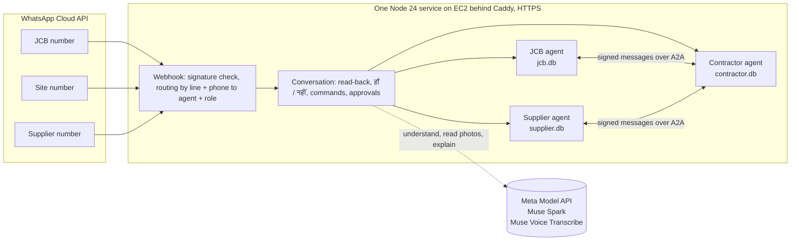

# Hisaab Bridge

**Every business gets its own agent that runs its books, and the agents talk to each other to get work done, so small businesses grow together instead of arguing.**

Each agent works for its own owner on WhatsApp: it keeps that business's ledger, asks the owner before committing anything, and connects to the agents of the businesses it deals with. Every deal leaves the same signed record on both sides. In this entry, three agents (a contractor's site office, a JCB owner's and a sand/cement supplier's) agree on bookings, hours, deliveries, bills and payments over A2A. **Muse reads, understands, plans and explains; code checks every figure; people decide.**

Built during the Meta Global AI Developer Hackathon (Startup track, *Build for Your World*), 27 October to 4 November 2026.

- **Live judge page:** https://16-4-100-70.sslip.io/judge/ (three ledgers side by side, every message with its signature check; inside the agent: every Muse call, every code check, every decision, live)
- **Agent Cards:** `https://16-4-100-70.sslip.io/agents/{jcb,site,supplier}/.well-known/agent-card.json`
- **Demo video:** *(link added at submission)*

## The problem

On an Indian building site a contractor hires a JCB by the hour and buys sand and cement by the bag or the trip. The JCB owner counts hours, the supplier counts bags, and the contractor's supervisor keeps a third count in a notebook. Payments go by UPI, and the proof is a screenshot forwarded on WhatsApp. At month end the counts and the payments do not match, and the argument costs everyone time, money and trust.

All of these people already live on WhatsApp. None of them will install an app or learn a form. So each business gets an agent on WhatsApp that speaks Hindi, takes photos and voice notes, and keeps a ledger that the other side can check.

## What a job looks like

```
Supervisor (WhatsApp)   "कल सुबह 8 बजे शिवपुरी साइट पर JCB चाहिए, 6 घंटे"   (text or voice note)
Contractor agent        over the approval limit? held as J-1 for the contractor's "ok J-1" (no read-back: the OK is
                        the check); within it, read back once -> हाँ -> signed BOOKING_REQUEST over A2A
JCB agent               asks the JCB owner; their exact "हाँ 1200" / "नहीं" / "30-10" is the answer -> signed BOOKING_REPLY
JCB operator            start and end hour-meter photos -> Muse Spark reads the digits -> code checks continuity -> hours
JCB owner               "भेजो" -> signed BILL, the meter photos' fingerprints as evidence
Contractor              sees the bill beside the supervisor's own count -> accept, or dispute with their figure
                        -> Muse Spark explains the difference from the evidence; code checks every number it cites
JCB owner               keeps the bill or sends a CORRECTION; nothing is ever rewritten
Contractor              sends the UPI screenshot -> Muse Spark reads amount, UTR, payee -> code picks the order by what is owed; the owner sees the payee
JCB owner               "आया" -> SETTLED on both ledgers
```

The material flow is the same with a supplier agent: an order with items, rates in the supplier's yes, a delivery with a challan photo read by Muse Spark, the supervisor's own count on arrival (48 of 50 bags becomes a dispute, not an argument), then bill, payment and settlement.
GST is part of the bill: the rate comes from the supplier's yes ("हाँ 380 + 28%") or from the tax invoice Muse Spark reads, code adds CGST + SGST to the paisa and checks the total against the invoice's grand total.

**Nothing is booked, sent, accepted, corrected or settled without the explicit WhatsApp reply of the person allowed to decide it.** There are no payment reminders and no chasing; the JCB owner sees "unpaid", the agent never nags.

One trade-off, made on purpose to save steps: a clear photo from the sender needs no extra reply. A clear meter reading is recorded, a clear challan becomes a signed delivery and a clear UPI screenshot becomes a signed payment claim at once. A claim or a delivery still has to pass the other side (the seller's "आया", the supervisor's own count), and that person is the check. An unclear photo is always asked about.

## Architecture



- **Signed messages** (`src/protocol/`): every message between agents is RFC 8785 canonical JSON signed with Ed25519, names its sender and addressee, expires, and carries a unique id. A misaddressed, expired or out-of-order message is refused with a signed `REFUSE` and writes nothing; a forged or altered one gets an unsigned error, never our signature; a repeat gets its original receipt and writes nothing.
- **Ledgers** (`src/ledger/`): each agent has its own append-only SQLite ledger, hash-chained. The chain has no secret, so on its own it shows only an edit that did not recompute the later hashes. A forced edit that does recompute them is caught by the other side's signed receipts, which name hashes of this chain: the server compares them at start and every 6 hours and tells the owners concerned, and the judge page compares them in the browser (limits below). Order states are enforced by code: no bill before work or delivery, settlement only for the payment in force on the bill in force, a correction names the bill it replaces.
- **A2A** (`src/transport/a2a.js`): the official `@a2a-js/sdk`, A2A 1.0 JSON-RPC. Each agent publishes an Agent Card with its id and public key; our signed message travels as a `data` part and the signed receipt comes back the same way. A2A is the envelope only; whether a message is genuine is decided by the protocol layer, never by the transport.
- **WhatsApp** (`src/wa/`): one webhook per line, `X-Hub-Signature-256` checked on the raw bytes before parsing, each message handled once, replies only inside the 24-hour window. A line is only transport: people are routed by `{line, phone}` to `{agent, role}`, so one phone can be a JCB owner on one number and a contractor on another.
- **Conversation** (`src/agents/conversation.js`): Muse Spark turns free words into one proposed tool call; the agent reads it back in Hindi and acts only on the person's हाँ. A person's own exact reply to a request open for them ("हाँ 380", "नहीं", "30-10", "बिल", typed figures) and a clear photo reading that code finds consistent act at once with one receipt, because each record already has a second person checking it downstream (`docs/BUILD2.md`, "Fewer steps"). Exact commands are parsed by code before any model: `status J-1`, `pending`, `stock`, `ok P-2`, `no P-2 <reason>`, `help` / `मदद`.
- **Approvals** (`src/agents/office.js`): a supervisor's order above the contractor's limit (or with no estimate) is held under its reference until the contractor replies `ok` or `no`. Nobody approves their own entry; a decision is made once.
- **Readers** (`src/readers/`): Muse Spark with a strict JSON schema decides what a photo is (meter, UPI receipt, challan, other) and reads the hour meter, the UPI screenshot and the delivery challan, printed and handwritten. Amounts become integer paise, quantities integer hundredths. An unsure reading says so and the person is asked; a value is never guessed. A meter photo is checked before it counts: a forwarded one is refused, Muse Spark compares it with the other reading's photo (same machine?), and a date on the display must be the job's.
- **Evidence on request** (`src/agents/evidence.js`): on a dispute, a count difference or `सबूत J-1`, an agent asks the other for the photo behind a record; the photo's owner is asked first and only their हाँ sends it, hash-checked against the fingerprint already in the asker's ledger; नहीं sends a signed refusal (`declined_by_owner`).
- **Explanations** (`src/agents/explain.js`): when two sides' figures differ, each agent gives Muse Spark the facts from its own ledger and gets back a short, neutral Hindi explanation of where the figures differ and what each rests on. Code checks that every number in it exists in the ledger and that it takes no side, tells no one to pay and invents no reason; otherwise only the plain figures go out.
- **Ask anything** (`src/agents/ask.js`): a question about one's own records goes to a read-only route. Muse Spark chooses lookups (orders, one order, totals, payments, material received) over that agent's own ledger, filtered by the person's role; code computes every figure; Muse Spark writes the answer, and code checks that every number came from a lookup and that it takes no side and asks no one to pay. Otherwise a plain answer written by code goes out. Nothing is written.
- **Inside the agent** (`src/trace/`): each agent keeps a working trace apart from its ledger (never in the hash chain or a message): which Muse model did which job, its latency and structured output, each named code check with its figures, who decided with which reply, each signed message and its receipt, each ledger row. The judge page shows it per order under each ledger, live every 3 s.

## Where Meta's models do the work

Every model called at runtime is Meta's, through the Meta Model API. A test (`test/rules/meta-only.test.js`) fails the build if any other model or provider appears in the source.

| Job | Model |
|---|---|
| Understanding a Hindi/Hinglish message (typed, forwarded or spoken), choosing the step, and asking only for what is missing | Muse Spark (tool calling) |
| Deciding what every incoming photo is (hour meter, UPI receipt, delivery challan or other) before the right reader runs; asks the person when unsure | Muse Spark (vision, strict schema) |
| Reading the hour meter, the UPI screenshot, the delivery challan (printed and handwritten on one page) | Muse Spark (vision, strict schema) |
| Explaining a difference between two parties' figures to each side, in Hindi, from that side's evidence | Muse Spark (strict schema, every number checked by code) |
| Answering any question about one's own records ("इस महीने शिवपुरी पर कितना सीमेंट आया?"): planning which read-only lookups to run, up to 4, and phrasing a short Hindi answer | Muse Spark (tool calling; code runs every lookup and checks every number) |
| Voice notes from the site | Muse Voice Transcribe |
| Hours, continuity, rates, amounts, matching payment to bill, signatures, permissions | Code, never a model |

## Measured results

Accuracy is measured on real photos from our pilot, labelled by a person, with the split frozen before the held-out run. The photos stay private; the aggregate reports are in `eval/results/`.

| Reader | Set | Exact | Asked the person | Wrong but confident | Median time |
|---|---|---|---|---|---|
| Hour meter | held-out, 10 real photos, split frozen 28 Oct | 6 / 10 | 4 / 10 | **0** | 9.0 s |
| Hour meter | development, 11 photos | 9 / 11 | 2 / 11 | 0 | |
| UPI screenshot | development, 9 PhonePe receipts | 6 / 9 whole receipts; amount, date, UTR, status and payee 9 / 9 each | 3 / 9 | 0 | 8.5 s |
| Kind of photo | held-out, 10 real meter photos | 10 / 10 | 0 | 0 | 6.1 s |
| Kind of photo | development, 11 meter + 9 UPI | 20 / 20 | 0 | 0 | 6.9 s |

The figure that matters most is the "wrong but confident" column: across all real images the readers were never confidently wrong. When unsure they ask the person, which costs one WhatsApp reply instead of a wrong bill. The held-out meter run cost about US$0.11 for 10 photos. It measured `meter-v1`; the shipped `meter-v2` adds a date field and memory of corrections and has not been re-run on held-out. With 10 photos, "never confidently wrong" still leaves a true rate that could be as high as about one in four.

**Explanations**, live with Muse Spark on 8 invented disputes (JCB hours, material counts, corrections): 8 / 8 passed the number and wording checks, median 3.75 s, slowest 5.6 s (`docs/explanation-live-check.md`). Eight cases show the path works; they are not a measured pass rate.

**Ask anything**, live with Muse Spark on 10 invented questions over invented ledgers (contractor, supervisor, JCB owner, supplier): 9 fully correct, 1 with right figures but missing the order's state, no wrong figure; 10 / 10 passed the number and wording checks; median 8.9 s, slowest 12.6 s for the whole question (`docs/ask-live-check.md`).

Not yet measured: UPI on unseen screenshots and other UPI apps, the challan reader and the photo-kind reader on real challans. Sample sizes are small and stated as such.

**Tests:** 887 automated tests (`node:test`), run on an AWS machine before every merge and deploy, with the TypeScript checker in strict mode over the JSDoc types. They cover the protocol (forged, altered, wrong addressee, expired, repeated, out of order), a crash between writing and answering (the message is written once and answered with the same receipt), whole jobs between agents with both ledgers agreeing at every step, the approval rules, intake that asks only for what is missing, exact replies and clear photos that act at once, evidence exchange with hash checks, the site's signed copy, the explanation and answer checks, and the judge page's file serving.

## What works today, honestly

- Running live on EC2 with HTTPS: three agents, their keys and ledgers, the webhooks, the judge page.
- The JCB WhatsApp number works end to end on real phones. Since 28 October all three agents run on it, each phone routed to its own agent and role (contractor, supervisor, supplier, JCB owner, JCB operator), while the contractor-side flow is tested with real people.
- The site and supplier numbers are Meta test numbers in separate business portfolios. As of 28 October the site number's business account is locked by Meta (error 131031), which we are resolving with Meta; until then all three agents can run on one number, routed by the sender's phone.
- Real pilot jobs with a JCB owner and a contractor we work with start only after our own full run passes.

## Known limits (next steps)

An independent audit found no critical or high issue. A later AI red-team review with Muse Wonder, on the public source only, claimed 20 findings (6 high, 10 medium, 4 low, none critical), including a replay of a signed refusal that the audit had called harmless. 19 were fixed, one of them only in part (oversized messages); the other is the order-splitting limit below. It is an AI review, not a certified penetration test. These are the limits we have not built past yet:

- **No request-rate limits** on the public endpoints. Forged messages are refused by their signature, but a flood could slow the service.
- **One shared viewer key** for the judge page, not one key per viewer, and it does not expire by itself.
- **Each WhatsApp message is handled at most once.** A crash in the middle of a message loses it. On an error the person is now told to send it again; a replay table comes later.
- **Ledger text from the other party still sits in the model's instructions** (site and item names, now limited to plain name characters). It is guarded by the tool list, the checks in code and the read-back; moving it out of the instructions comes later.
- **A person who stays silent gets nothing.** There are no template messages, so someone who has not written in the last 24 hours cannot be sent a notice, and there are no reminders. When they next write, each agent first tells them what is still open and waiting for them, rebuilt from its ledger: for the contractor a bill or correction in force and an approval request, for the supervisor a delivery waiting for the count, for both another day a seller offered, for the sellers an open order, objection or reported payment. Notices that only inform (a settlement, a cancellation, a count told) are not told again.
- **An approval is stored before its order runs.** A crash in that moment leaves it approved and never sent, with no automatic retry.
- **A combined payment's split is worked out again at the "हाँ".** If a bill changes after the read-back, the split recorded can differ from the one shown.
- **A wrong count can still be entered.** The agent cannot know what actually reached the site. The contractor is told each supervisor count that equals the challan, and whether it was a plain yes, typed figures or a photo, and can object when the bill comes; nothing stops a false figure being entered, and a plain yes proves nobody counted.
- **A supervisor can split one need into several orders under the approval limit.** The contractor is told of each order, but they are not added up against the limit.
- **All three agents run in one process on one host.** They keep separate keys and ledgers and talk only over A2A, but a compromise of that host reaches all three.
- **The cross-check through receipts reaches only as far as the last receipt.** Rows written after the last receipt from that peer can't be checked, so their edit or deletion goes unseen until a later receipt names a head after them; a seller's own sent bill is among those rows until it next receives a message.
- **All three agents and their signing keys sit on one server today.** Someone with full server access could rewrite all three ledgers and re-sign them consistently. Only a copy of the chain heads held off the server would catch that, and that isn't built.
- **Rows with no receipt relation stay covered only by what the chain gives.** A local note has no receipt of its own; it is caught only when a later receipt names a head after it.
- **The UPI payee is shown, not checked.** Code does not compare it with the seller; the seller's own "आया" is the check.
- **The explanation's wording check is a list of banned phrases.** Its number check is strict, but a sentence can be paraphrased past the wording check, so code's plain figures are always added after the prose.
- **The first meter reading of a job has no continuity check,** since there is no earlier reading to compare it with.
- **A reply is read as an answer to the latest open question first.** While a bill is open, a message listing only that bill's items, with no site, day or time, is read back as an objection even if it was meant as a new order. A "नहीं" at the read-back stops it, and naming a site or day keeps it a new order.
- **A booking does not name a machine.** The agents cannot tell if another JCB does the whole job, and a machine swapped mid-job cannot be recorded: its end photo is refused and a job with a reading cannot be cancelled.
- **An edited or cropped photo is not detected.** Cropping out the date passes the date check, and the display's clock is not compared with the time.
- **The two sides' challan checks are not independent when both send the same photo.** On 31 October a live challan listing its items in another order put 40 bags instead of 50 on a signed delivery, and both checks agreed. The matching is fixed, and the invoice's grand total still differed from the bill's, but a person's own count is the real check.

## Roadmap: how the network grows

Not built yet; this is where the same design goes.

1. **Every business, its own agent.** The JCB owner and the supplier are the first two. A kiln, a transporter, a labour contractor or a hardware shop is the same pattern: its own keys, its own ledger, its own WhatsApp conversation.
2. **Agents find each other.** Each agent publishes an Agent Card with what it offers, where, and its public key. A contractor's agent asks every JCB owner or supplier in the area at once, waits for their answers, and brings the contractor the options: who, when, at what rate. One reply chooses; the others are told, signed, that they are not needed.
3. **No agent yet? Still in the network.** An owner the contractor already knows can answer on plain WhatsApp, after agreeing to receive requests. That answer is marked as unsigned. After the job, the owner is invited to get an agent of their own, so every deployed agent brings in the next business. The network grows from any agent, not from us.
4. **One person, many businesses.** A contractor who also rents out his own JCB runs both from one phone, with one role per message.
5. **A track record that travels.** Settled jobs, on-time deliveries and resolved disputes are signed by both sides; a business can show that history to a new partner, with its consent.
6. **Each business on its own number.** Today all agents share one Meta test number, routed per phone; in production each business has its own WhatsApp number, with approved templates for the first message.

## Business model

Not charging anyone yet, and no price is set; this is the plan we will test.

- **Who pays:** each business with an agent (contractor, JCB owner, supplier) pays us, the people running the service, a fee per settled job. The money for the job itself still goes directly between the businesses; we never hold it.
- **First customers:** a contractor, with the JCB owner they already hire as the first business connected to them. Keeping these first pairs active matters more to us than any new feature.
- **What the price must cover:** the model calls and WhatsApp charges for each job. We have measured model cost only for reading: about US$0.11 for 10 meter photos. The cost of a whole job is not measured yet.
- **Later:** with both sides' consent, a counter-signed history of settled jobs could help a small business show its record to a new partner or a lender. This is an idea, not something built or tested.

## Run it

Requires Node 24.

```
npm ci
npm test
npm run typecheck
```

The judge page runs locally with `node web/serve.js` on the bundled sample export. Deploying to your own server (Ubuntu, Caddy, systemd, WhatsApp webhooks) is described in `deploy/README.md`. Settings come only from `HB_*` environment variables and a private data folder; nothing secret is in this repository.

## Repository map

| Path | What |
|---|---|
| `src/protocol/` | canonical JSON, Ed25519 keys, message schemas, receiving rules |
| `src/ledger/` | append-only hash-chained ledger, order states, references |
| `src/transport/a2a.js` | A2A over the official SDK |
| `src/agents/` | the three agents, the WhatsApp conversation, approvals, material |
| `src/readers/` | meter, UPI and challan readers |
| `src/meta/` | Meta Model API client |
| `src/wa/` | WhatsApp webhook, routing, store, voice notes |
| `src/i18n/` | Hindi texts |
| `web/` | judge page |
| `eval/` | accuracy measurement and the aggregate results |
| `docs/` | `CONTRACTS.md` (interfaces), `BUILD2.md` (supplier, approvals, references), `STATUS.md` (daily progress) |

## Disclosure

Our application proposed a WhatsApp site office that turns contractors' field photos and messages into checked records for the owner. We built it during the event, and it grew into a bridge: the contractor's site office now settles hours, deliveries and payments with its suppliers' agents (a JCB owner's and a sand/cement supplier's) over signed A2A messages. The contractor, JCB and supplier agents are all new, and all code in this repository was written during the event, from 27 October 2026.

Our previous private project is Bhatta Munshi, a WhatsApp bookkeeping agent running daily at our own brick kiln, described in our application. What we learned there (the person confirms before anything is recorded, code checks every figure the model reads) shaped this design. No code from it is used, and it is not part of this entry. The organisers confirmed that mentioning it as context is fine.

Pilot users: a JCB owner and a contractor we work with, with their consent. All data in this repository is invented; real photos, phone numbers and payments stay on the private server.

Built by the owner with AI coding tools, all disclosed: Claude Code (lead and integrator), Astra (readers and measurement), Fable (Hindi texts, contractor features, judge page) and Codex. No code predates the event. Claude Code, Astra and Fable wrote it in parallel sessions, each in its own git worktree, and Astra's ultra mode itself runs parallel agents. Their work is merged in batches, which is why large tested commits can land minutes apart.

## Licence

Apache License 2.0.
