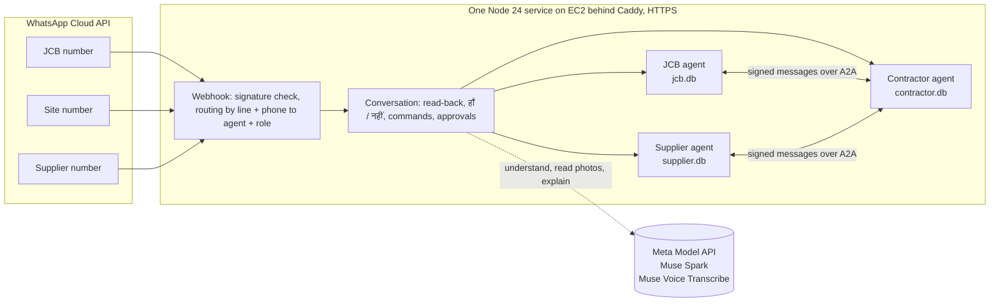

# Hisaab Bridge

**Every business gets its own agent that runs its books, and the agents talk to each other to get work done, so small businesses grow together instead of arguing.**

Each agent works for its own owner on WhatsApp: it keeps that business's ledger, asks the owner before committing anything, and connects to the agents of the businesses it deals with. Every deal leaves the same signed record on both sides. In this entry, three agents (a contractor's site office, a JCB owner's and a sand/cement supplier's) agree on bookings, hours, deliveries, bills and payments over A2A. **Muse reads, understands, plans and explains; code checks every figure; people decide.**

Built during the Meta Global AI Developer Hackathon (Startup track, *Build for Your World*), 27 October to 4 November 2026.

- **Live judge page:** https://16-4-100-70.sslip.io/judge/ (three ledgers side by side, every message with its signature check)
- **Agent Cards:** `https://16-4-100-70.sslip.io/agents/{jcb,site,supplier}/.well-known/agent-card.json`
- **Demo video:** *(link added at submission)*

## The problem

On an Indian building site a contractor hires a JCB by the hour and buys sand and cement by the bag or the trip. The JCB owner counts hours, the supplier counts bags, and the contractor's supervisor keeps a third count in a notebook. Payments go by UPI, and the proof is a screenshot forwarded on WhatsApp. At month end the counts and the payments do not match, and the argument costs everyone time, money and trust.

All of these people already live on WhatsApp. None of them will install an app or learn a form. So each business gets an agent on WhatsApp that speaks Hindi, takes photos and voice notes, and keeps a ledger that the other side can check.

## What a job looks like

```
Supervisor (WhatsApp)   "कल सुबह 8 बजे शिवपुरी साइट पर JCB चाहिए, 6 घंटे"   (text or voice note)
Contractor agent        reads it back -> हाँ -> over the approval limit? held as J-1 for the contractor's "ok J-1"
                        -> signed BOOKING_REQUEST over A2A
JCB agent               asks the JCB owner: हाँ / नहीं / दूसरा समय -> signed BOOKING_REPLY with the rate
JCB operator            start and end hour-meter photos -> Muse Spark reads the digits -> code checks continuity -> hours
JCB owner               "भेजो" -> signed BILL, the meter photos' fingerprints as evidence
Contractor              sees the bill beside the supervisor's own count -> accept, or dispute with their figure
                        -> Muse Spark explains the difference from the evidence; code checks every number it cites
JCB owner               keeps the bill or sends a CORRECTION; nothing is ever rewritten
Contractor              sends the UPI screenshot -> Muse Spark reads amount, UTR, payee -> code matches it to the bill
JCB owner               "आया" -> SETTLED on both ledgers
```

The material flow is the same with a supplier agent: an order with items, rates in the supplier's yes, a delivery with a challan photo read by Muse Spark, the supervisor's own count on arrival (48 of 50 bags becomes a dispute, not an argument), then bill, payment and settlement.

**Nothing is booked, sent, accepted, corrected or settled without the explicit WhatsApp reply of the person allowed to decide it.** There are no payment reminders and no chasing; the JCB owner sees "unpaid", the agent never nags.

## Architecture



- **Signed messages** (`src/protocol/`): every message between agents is RFC 8785 canonical JSON signed with Ed25519, names its sender and addressee, expires, and carries a unique id. A forged, altered, misaddressed, expired, repeated or out-of-order message is refused with a signed `REFUSE` and writes nothing.
- **Ledgers** (`src/ledger/`): each agent has its own append-only SQLite ledger, hash-chained, so a forced edit is detected. Order states are enforced by code: no bill before work or delivery, settlement only for the payment in force on the bill in force, a correction names the bill it replaces.
- **A2A** (`src/transport/a2a.js`): the official `@a2a-js/sdk`, A2A 1.0 JSON-RPC. Each agent publishes an Agent Card with its id and public key; our signed message travels as a `data` part and the signed receipt comes back the same way. A2A is the envelope only; whether a message is genuine is decided by the protocol layer, never by the transport.
- **WhatsApp** (`src/wa/`): one webhook per line, `X-Hub-Signature-256` checked on the raw bytes before parsing, each message handled once, replies only inside the 24-hour window. A line is only transport: people are routed by `{line, phone}` to `{agent, role}`, so one phone can be a JCB owner on one number and a contractor on another.
- **Conversation** (`src/agents/conversation.js`): Muse Spark turns a message into one proposed tool call; the agent reads it back in Hindi and acts only on the person's हाँ. Exact commands are parsed by code before any model: `status J-1`, `pending`, `stock`, `ok P-2`, `no P-2 <reason>`, `help` / `मदद`.
- **Approvals** (`src/agents/office.js`): a supervisor's order or payment above the contractor's limit (or with no estimate) is held under its reference until the contractor replies `ok` or `no`. Nobody approves their own entry; a decision is made once.
- **Readers** (`src/readers/`): Muse Spark with a strict JSON schema decides what a photo is (meter, UPI receipt, challan, other) and reads the hour meter, the UPI screenshot and the delivery challan, printed and handwritten. Amounts become integer paise, quantities integer hundredths. An unsure reading says so and the person is asked; a value is never guessed.
- **Explanations** (`src/agents/explain.js`): when two sides' figures differ, each agent gives Muse Spark the facts from its own ledger and gets back a short, neutral Hindi explanation of where the figures differ and what each rests on. Code checks that every number in it exists in the ledger and that it takes no side, tells no one to pay and invents no reason; otherwise only the plain figures go out.

## Where Meta's models do the work

Every model called at runtime is Meta's, through the Meta Model API. A test (`test/rules/meta-only.test.js`) fails the build if any other model or provider appears in the source.

| Job | Model |
|---|---|
| Understanding a Hindi/Hinglish message (typed, forwarded or spoken), choosing the step, and asking only for what is missing | Muse Spark (tool calling) |
| Deciding what every incoming photo is (hour meter, UPI receipt, delivery challan or other) before the right reader runs; asks the person when unsure | Muse Spark (vision, strict schema) |
| Reading the hour meter, the UPI screenshot, the delivery challan (printed and handwritten on one page) | Muse Spark (vision, strict schema) |
| Explaining a difference between two parties' figures to each side, in Hindi, from that side's evidence | Muse Spark (strict schema, every number checked by code) |
| Voice notes from the site | Muse Voice Transcribe |
| Hours, continuity, rates, amounts, matching payment to bill, signatures, permissions | Code, never a model |

## Measured results

Accuracy is measured on real photos from our pilot, labelled by a person, with the split frozen before the held-out run. The photos stay private; the aggregate reports are in `eval/results/`.

| Reader | Set | Exact | Asked the person | Wrong but confident | Median time |
|---|---|---|---|---|---|
| Hour meter | held-out, 10 real photos, split frozen 28 Oct | 6 / 10 | 4 / 10 | **0** | 9.0 s |
| Hour meter | development, 11 photos | 9 / 11 | 2 / 11 | 0 | |
| UPI screenshot | development, 9 PhonePe receipts | 6 / 9 whole receipts; amount, date, UTR, status and payee 9 / 9 each | 3 / 9 | 0 | 8.5 s |
| Kind of photo | held-out, 10 real meter photos | 10 / 10 | 0 | 0 | 6.1 s |
| Kind of photo | development, 11 meter + 9 UPI | 20 / 20 | 0 | 0 | 6.9 s |

The figure that matters most is the "wrong but confident" column: across all real images the readers were never confidently wrong. When unsure they ask the person, which costs one WhatsApp reply instead of a wrong bill. The held-out meter run cost about US$0.11 for 10 photos.

**Explanations**, live with Muse Spark on 8 invented disputes (JCB hours, material counts, corrections): 8 / 8 passed the number and wording checks, median 3.75 s, slowest 5.6 s (`docs/explanation-live-check.md`). Eight cases show the path works; they are not a measured pass rate.

Not yet measured: UPI on unseen screenshots and other UPI apps, the challan reader and the photo-kind reader on real challans. Sample sizes are small and stated as such.

**Tests:** 338 automated tests (`node:test`), run on an AWS machine before every merge and deploy, with the TypeScript checker in strict mode over the JSDoc types. They cover the protocol (forged, altered, wrong addressee, expired, repeated, out of order), a crash between writing and answering (the message is written once and answered with the same receipt), whole jobs between agents with both ledgers agreeing at every step, the approval rules, intake that asks only for what is missing, the explanation checks, and the judge page's file serving.

## What works today, honestly

- Running live on EC2 with HTTPS: three agents, their keys and ledgers, the webhooks, the judge page.
- The JCB WhatsApp number works end to end on real phones. Since 28 October all three agents run on it, each phone routed to its own agent and role (contractor, supervisor, supplier, JCB operator), while the contractor-side flow is tested with real people.
- The site and supplier numbers are Meta test numbers in separate business portfolios. As of 28 October the site number's business account is locked by Meta (error 131031), which we are resolving with Meta; until then all three agents can run on one number, routed by the sender's phone.
- Real pilot jobs with a JCB owner and a contractor we work with start only after our own full run passes.

## Run it

Requires Node 24.

```
npm ci
npm test
npm run typecheck
```

The judge page runs locally with `node web/serve.js` on the bundled sample export. Deploying to your own server (Ubuntu, Caddy, systemd, WhatsApp webhooks) is described in `deploy/README.md`. Settings come only from `HB_*` environment variables and a private data folder; nothing secret is in this repository.

## Repository map

| Path | What |
|---|---|
| `src/protocol/` | canonical JSON, Ed25519 keys, message schemas, receiving rules |
| `src/ledger/` | append-only hash-chained ledger, order states, references |
| `src/transport/a2a.js` | A2A over the official SDK |
| `src/agents/` | the three agents, the WhatsApp conversation, approvals, material |
| `src/readers/` | meter, UPI and challan readers |
| `src/meta/` | Meta Model API client |
| `src/wa/` | WhatsApp webhook, routing, store, voice notes |
| `src/i18n/` | Hindi texts |
| `web/` | judge page |
| `eval/` | accuracy measurement and the aggregate results |
| `docs/` | `CONTRACTS.md` (interfaces), `BUILD2.md` (supplier, approvals, references), `STATUS.md` (daily progress) |

## Disclosure

Our application proposed a WhatsApp site office that turns contractors' field photos and messages into checked records for the owner. We built it during the event, and it grew into a bridge: the contractor's site office now settles hours, deliveries and payments with its suppliers' agents (a JCB owner's and a sand/cement supplier's) over signed A2A messages. The contractor, JCB and supplier agents are all new, and all code in this repository was written during the event, from 27 October 2026.

Our previous private project is Bhatta Munshi, a WhatsApp bookkeeping agent running daily at our own brick kiln, described in our application. What we learned there (the person confirms before anything is recorded, code checks every figure the model reads) shaped this design. No code from it is used, and it is not part of this entry. The organisers confirmed that mentioning it as context is fine.

Pilot users: a JCB owner and a contractor we work with, with their consent. All data in this repository is invented; real photos, phone numbers and payments stay on the private server.

Built by the owner with AI coding tools, all disclosed: Claude Code (lead and integrator), Astra (readers and measurement), Fable (Hindi texts, contractor features, judge page) and Codex.

## Licence

Apache License 2.0.
